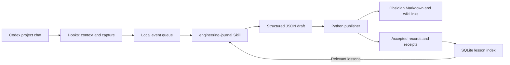

# Codex × Obsidian Engineering Journal

English · [简体中文](README.md)

Help Codex consult relevant lessons before development and turn decisions, debugging sessions, and verified milestones into Obsidian notes. Switch to explanatory mode in chat to build a reading guide for understanding the project.

The project uses the Python 3.13 standard library and stores its data locally. Codex Hooks and a Skill drive the workflow; Obsidian displays ordinary Markdown, wiki links, and its native graph.

## Features

- **Targeted recall:** SQLite FTS5 searches task keywords, returning up to 3 cards within 2,400 characters by default. Results favor the current project; cross-project results require explicitly reusable lessons.
- **Evidence-backed records:** Decisions, pitfalls, and milestones keep factual status, cause certainty, and test outcomes separate, including failed attempts.
- **Project explanations:** Chat-controlled concise and explanatory modes add goals, module roles, execution flow, and terminology to future records and a linked project guide.
- **Native graph:** Full Vault-relative wiki links connect project pages, progress, records, and reusable knowledge.
- **Checked publication:** The publisher validates draft structure, project scope, evidence SHA-256, and file ownership, retaining versions and receipts.
- **Bounded follow-up:** Stop can request one continuation for significant pending events in the current turn. Unprocessed evidence remains local.

## Workflow



Hooks provide triggers and evidence. Codex uses the Skill to assess significance and write drafts; the publisher validates and saves them. The search index is built from accepted records with matching receipts, keeping the entire Vault out of model context.

## Installation

### Requirements

- Windows; the verified runtime is Python 3.13 with SQLite FTS5 available.
- Codex desktop or CLI with SessionStart, PostToolUse, and Stop command Hooks.
- Obsidian with core plugins. Its official CLI is needed only for optional client diagnostics.
- Git to clone the repository. Python scripts need no third-party packages.

The installation policy and bundled Skill currently use `D:\Computer-Science\C-obsidian`. Use this location for an initial installation. Relocating requires updating the policy text in `bootstrap.py` and absolute paths in the bundled Skill.

### First installation

Run in PowerShell with `python` pointing to Python 3.13:

```powershell
git clone https://github.com/haixianma422-maker/C-obsidian.git D:\Computer-Science\C-obsidian
Set-Location D:\Computer-Science\C-obsidian
python --version
python bootstrap.py init
python journal.py doctor
python bootstrap.py install
```

When configuration is absent, `init` creates local `projects.json`, a dedicated `Test-Vault`, and registrations for the journal system and `demo-project`. See [projects.example.json](projects.example.json). `install` merges user-level AGENTS, Hooks, and the Skill, backing up previous configuration under `state/install-backups/`.

Review and trust the current SessionStart, PostToolUse, and Stop definitions in Codex CLI `/hooks`, then open a desktop chat in a registered project. Changed Hook commands require a new review.

> [!IMPORTANT]
> Existing installations do not need repeated initialization or installation. Do not clone over an existing deployment; preserve local configuration, the Vault, and runtime data during source updates.

## Daily use

### 1. Register a real project

Ask Codex to register your actual project directory, or run:

```powershell
python journal.py register my-project 'D:\Projects\MyProject' --name 'My project'
```

Open that directory as a Codex desktop project and work normally. No startup script is required for each chat. Matching uses the chat's actual working directory; nested projects use the longest matching root.

### 2. Develop and recall lessons

Give Codex a development task as usual. An optional reminder is:

> Retrieve lessons relevant to this task, check whether they still apply to the current code, then make the change.

Ordinary questions and mechanical edits generally do not produce separate notes. Historical lessons help select verification steps; changed sources, uncertain causes, and unrun tests retain their respective status.

### 3. Choose the level of explanation

> Enable explanatory mode for this project. Include its goal, module relationships, execution flow, and reasons for the change.

> Switch this project to concise mode.

Modes persist per project and affect future drafts. Existing notes remain intact. Explanations require code or documentation evidence. The equivalent commands are:

```powershell
python journal.py mode --project my-project --set explanatory
python journal.py mode --project my-project --set concise
```

See the [recall and explanation guide](docs/recall-and-explanatory-mode.md) in Chinese.

### 4. Read notes and explore the graph

Open the configured Vault in Obsidian, by default `D:\Computer-Science\C-obsidian\Test-Vault`, and start at `Engineering/Index.md`.

| Page or folder | Contents |
| --- | --- |
| Overview | Project navigation |
| Progress | Progress and open issues |
| Decisions | Choices, reasons, and trade-offs |
| Pitfalls | Symptoms, failed attempts, causes, and fixes |
| Milestones | Completed work and verification |
| Project-Guide 项目讲解 | Explanations and a reading path |
| Reusable-Knowledge | Cross-project lessons with applicability conditions |

Open a local graph from the project overview with depth 2. See the [note and graph conventions](docs/note-format.md) in Chinese. Generated navigation and status labels currently favor Chinese; the English README does not imply a fully localized renderer.

The publisher manages generated notes. Add personal annotations as separate linked notes. Manual changes to managed files trigger hash-based overwrite protection.

## Maintenance and evidence

Run from the repository root:

```powershell
python journal.py doctor              # Environment and registrations
python journal.py pending             # Pending events
python journal.py audit               # Static wiki-link audit
python journal.py index               # Rebuild lesson-search cache
python journal.py events-index        # Rebuild pending-event pointers
```

Codex creates drafts using the [draft protocol](.agents/skills/engineering-journal/references/protocol.md) and [JSON Schema](schemas/entry.schema.json), then invokes the publisher. To collect reliable test-execution evidence:

```powershell
python journal.py run --project my-project --session SESSION --turn TURN -- python -m unittest
python publisher.py .\outbox\my-draft.json
```

`run` executes the argument array directly, applies a 90-second limit, and retains a bounded excerpt with common secret patterns redacted. A Windows Job Object constrains the test process and descendants; timeout returns 124. Unknown Hook exit metadata stays unknown and cannot establish a passing test.

Publication is complete only when `published` or `unchanged` has a matching receipt and file hash. `needs_review` and `rejected` retain pending work. The publisher checks structure and evidence references; explanations and decision reasons still depend on the actual development context.

Backups include the Vault, events, drafts, accepted records, historical versions, receipts, and configuration:

```powershell
python journal.py backup 'D:\JournalBackups\journal-20261010.zip'
python journal.py restore 'D:\JournalBackups\journal-20261010.zip' 'D:\JournalRestore\new-copy'
```

The archive must be a new file outside the Vault. Restore requires a new directory. Review absolute paths in the restored configuration before activating it.

## Testing

```powershell
python -m unittest discover -s tests -v
```

Automated tests use isolated temporary registries and Vaults. Coverage includes publication, evidence, ownership protection, recall, explanatory mode, Hook protocol, event caching, and process management.

Local acceptance on 2026-10-10 completed 82 tests, a real 90-second timeout check, Obsidian window and link checks, and a real desktop SessionStart → PostToolUse → Stop continuation → publication-receipt cycle. Runtime logs and session evidence remain on the original machine and are excluded from source distribution. These results describe that Windows environment; a new installation needs its own acceptance checks.

Optional integration checks:

```powershell
python acceptance.py
& .\Start-JournalCodex.ps1 -Test
```

`acceptance.py` writes demonstration records to the configured dedicated Vault and executes an intentional failure followed by a correction. Use a dedicated test Vault. The launcher test runs real Codex, requires authentication, trusted Hooks, and a working Windows sandbox, has a 240-second total limit, and consumes Codex usage.

A restricted Windows sandbox may deny junction creation during test setup. Treat this as an environment failure, not a passing protection test. Client diagnostics also contain machine-specific paths and assumptions about existing acceptance records; read [tools/README.md](tools/README.md) before running them.

## Repository layout

```text
bootstrap.py                 Initialization and global installation
hook.py                      Codex lifecycle bridge
journal.py                   Registration, recall, modes, collection, maintenance
publisher.py                 Validation, publication, versions, receipts
knowledge.py                 SQLite FTS5 index
event_store.py               Pending-event pointers and acknowledgement
journal_core.py / schema.py  Paths, locks, redaction, registry, draft structure
process_runner.py            Test-process and descendant lifetime
.agents/skills/              Bundled engineering-journal Skill
schemas/                    Exported JSON Schema
tests/ / demo-project/      Regression tests and acceptance example
docs/ / tools/              Guides and machine-specific diagnostics
projects.example.json       Example registry
```

`.gitignore` excludes local `projects.json`, `events/`, `outbox/`, `state/`, Vaults, backups, and diagnostic artifacts. Git stores the program; the backup command preserves engineering history.

## Scope

- The workflow applies to registered local projects. The Skill does not grant filesystem permissions.
- Windows has been verified; WSL path mapping and other platforms have not completed end-to-end acceptance.
- Keyword search can miss synonyms. The character limit is not a fixed token budget.
- Pattern-based redaction cannot identify every secret. Reference only necessary evidence files and excerpts.
- The project itself calls no AI API. Your active Codex session writes the records.

## References

- [Codex Hooks](https://learn.chatgpt.com/docs/hooks) and [Skills](https://learn.chatgpt.com/docs/build-skills)
- [Obsidian Graph view](https://help.obsidian.md/plugins/graph)
- [SQLite FTS5](https://www.sqlite.org/fts5.html)
- [Architecture Decision Records](https://github.com/architecture-decision-record/architecture-decision-record)
