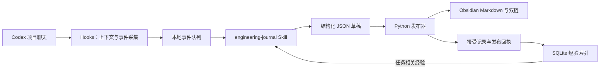

# Codex × Obsidian Engineering Journal

[English](README.en.md) · 简体中文

让 Codex 在开发前查阅相关经验，在开发后把关键决策、排查过程和验证结果整理成 Obsidian 笔记。通过聊天开启解释模式，还能把工程记录变成理解项目的阅读入口。

本项目使用 Python 3.13 标准库，将数据保存在本地。记录流程由 Codex 的 Hooks 和 Skill 驱动，Obsidian 使用原生 Markdown、双链和关系图谱。

## 让 Codex 帮你安装

复制下面这段话，发给你电脑上的 Codex：

```text
请阅读 https://github.com/haixianma422-maker/C-obsidian/blob/main/README.md，按照安装说明，在我的 Windows 电脑上安装并配置 C-obsidian。先检查环境和已有安装，保留现有配置与笔记，完成可执行的验证，并告诉我需要亲自完成的登录和 Hook 信任步骤。
```

Codex 可按下文步骤检查依赖、获取源码、初始化专用 Vault 并安装 Hooks 与 Skill。仓库目前为私有，需要你的 GitHub 账号有访问权限；Hook 信任由你本人审核。已经安装时先核对状态和版本，再决定是否更新。安装结果应分别核对环境检查、隔离测试，以及已注册项目聊天中的实际采集和发布回执。

手动安装步骤见[安装](#安装)。

## 功能

- **按需回忆**：SQLite FTS5 按任务关键词检索，默认最多 3 张经验卡、总输出 2400 个字符；优先本项目，仅跨项目返回明确可复用的经验。
- **有依据的记录**：保存技术决策、问题与修复、阶段里程碑，区分事实状态、原因确认程度和测试结果，保留失败尝试。
- **项目讲解**：聊天切换简洁 / 解释模式，后续记录补充项目目标、模块作用、执行流程和术语，并生成项目讲解页。
- **原生图谱**：项目主页、进度、记录和共享经验使用完整路径双链连接；核心 Graph view 即可展示关系。
- **可检查的发布**：校验草稿结构、项目范围、证据 SHA-256 和文件所有权；保留版本与发布回执。
- **有限补漏**：Stop 对本轮未处理的重要事件最多请求一次补记；未完成的事件留在本地。

## 工作流程



Hooks 提供触发和证据，Codex 使用 Skill 判断哪些内容值得记录并撰写草稿，发布器负责验证和落盘。索引从已接受且回执匹配的记录构建，不把整个 Vault 送入模型上下文。

## 安装

### 环境

- Windows；已验证的运行时为 Python 3.13，需启用 SQLite FTS5。
- 支持 SessionStart、PostToolUse、Stop 命令 Hooks 的 Codex 桌面版或 CLI。
- Obsidian；日常阅读使用核心插件。官方 Obsidian CLI 仅用于可选客户端诊断。
- Git，用于克隆仓库。Python 脚本无需安装第三方包。

当前安装策略和打包 Skill 使用固定目录 `D:\Computer-Science\C-obsidian`。首次安装请使用该位置；改到其他目录时，需要同步调整 `bootstrap.py` 的策略文本和打包 Skill 中的绝对路径。

### 首次安装

在 PowerShell 中执行，`python` 应指向 Python 3.13：

```powershell
git clone https://github.com/haixianma422-maker/C-obsidian.git D:\Computer-Science\C-obsidian
Set-Location D:\Computer-Science\C-obsidian
python --version
python bootstrap.py init
python journal.py doctor
python bootstrap.py install
```

`init` 在配置不存在时生成本机 `projects.json`，默认创建专用 `Test-Vault` 并登记系统本身及 `demo-project`。配置结构见 [projects.example.json](projects.example.json)。`install` 合并用户级 AGENTS、Hooks 和 Skill，原配置备份至 `state/install-backups/`。

安装后，在 Codex CLI 的 `/hooks` 中审核并信任当前 SessionStart、PostToolUse、Stop 定义，再打开一个已注册项目的桌面聊天。命令定义改变后需要重新审核。

> [!IMPORTANT]
> 已部署的用户无需重复初始化或安装。不要把仓库克隆到现有项目目录之上；更新源码时保留本机配置、Vault 和运行数据。

## 日常使用

### 1. 登记真实项目

在聊天中说：

> 把 `D:\Projects\MyProject` 注册到工程记录系统。

也可以执行：

```powershell
python journal.py register my-project 'D:\Projects\MyProject' --name '我的项目'
```

随后在 Codex 桌面版打开该实际文件夹并正常开发，无需每次运行启动脚本。匹配依据是聊天的实际工作目录；嵌套项目选择最长匹配路径。

### 2. 正常开发与回忆

可以直接提出开发任务。需要强调经验复用时说：

> 先检索与这次任务有关的历史经验，核对当前代码是否仍适用，再开始修改。

普通问答和机械修改通常不产生独立笔记。历史经验用于帮助选择验证步骤；来源变化、未确认原因和未运行测试会保留相应状态。

### 3. 切换解释模式

> 对当前项目开启解释模式，记录目标、模块关系、执行流程和修改原因。

> 对当前项目切换简洁模式。

设置按项目保存，作用于后续草稿；已有笔记保留。解释内容需要引用代码或文档证据。详见[按需检索与解释模式](docs/recall-and-explanatory-mode.md)。

### 4. 阅读笔记和图谱

在 Obsidian 中打开配置的 Vault，默认是 `D:\Computer-Science\C-obsidian\Test-Vault`。从 `Engineering/Index.md` 进入项目：

| 入口 | 内容 |
| --- | --- |
| Overview | 项目主页与记录导航 |
| Progress | 阶段进展与开放问题 |
| Decisions | 技术选择、依据与取舍 |
| Pitfalls | 现象、失败尝试、原因和修复 |
| Milestones | 已完成工作与验证结果 |
| Project-Guide 项目讲解 | 解释模式生成的项目讲解与阅读路径 |
| Reusable-Knowledge | 有适用条件的跨项目经验 |

在项目主页打开局部关系图，深度设为 2。详见[笔记格式与图谱约定](docs/note-format.md)。当前生成的导航和状态文字以中文为主；英文 README 不代表笔记渲染器已完整支持英文。

自动生成的笔记由发布器管理。个人补充可写成旁边的独立笔记并用双链关联；受管文件被手动改动后，发布器会检测哈希变化并阻止覆盖。

## 维护与证据

从项目根目录运行：

```powershell
python journal.py doctor              # 环境与注册范围
python journal.py pending             # 未处理事件
python journal.py audit               # 静态双链检查
python journal.py index               # 重建经验检索缓存
python journal.py events-index        # 重建未处理事件指针
```

Codex 按[草稿协议](.agents/skills/engineering-journal/references/protocol.md)和 [JSON Schema](schemas/entry.schema.json)生成草稿，再调用发布器。需要可靠的测试执行证据时使用：

```powershell
python journal.py run --project my-project --session SESSION --turn TURN -- python -m unittest
python publisher.py .\outbox\my-draft.json
```

`run` 真实执行参数数组中的命令，最多 90 秒，输出有长度限制并经过常见秘密模式脱敏。Windows Job Object 约束测试及其子进程；超时返回 124。未知 Hook 退出码保留为未知，不能据此声明测试通过。

发布结果为 `published` 或 `unchanged` 且匹配回执、文件哈希时，才视为完成。`needs_review` 和 `rejected` 会保留待处理内容。发布器验证结构和证据引用，项目讲解及决策理由仍需根据实际上下文撰写。

备份包含 Vault、事件、草稿、接受记录、历史版本、回执和配置：

```powershell
python journal.py backup 'D:\JournalBackups\journal-20261010.zip'
python journal.py restore 'D:\JournalBackups\journal-20261010.zip' 'D:\JournalRestore\new-copy'
```

备份目标必须是 Vault 外的新文件；恢复目标必须是全新目录。恢复后核对配置中的绝对路径，再决定是否启用。

## 测试

```powershell
python -m unittest discover -s tests -v
```

自动化测试使用隔离临时配置与 Vault，覆盖发布、证据、所有权保护、检索、解释模式、Hook 协议、事件缓存和进程管理。

2026-10-10 的本机验收完成了 82 项测试、真实 90 秒超时检查、Obsidian 客户端显示与双链检查，以及真实桌面 SessionStart → PostToolUse → Stop 补漏 → 发布回执链路。运行日志和会话证据保留在本机，不随源码上传；这些结果描述该次 Windows 环境，不替代新安装的验收。

可选集成检查：

```powershell
python acceptance.py
& .\Start-JournalCodex.ps1 -Test
```

`acceptance.py` 会向当前专用 Vault 写入演示记录并执行一次故意失败及修复测试；请使用专用测试库。启动器测试运行真实 Codex，需登录、信任 Hooks 和可工作的 Windows 沙箱，有 240 秒总时限并会使用 Codex 额度。

受限 Windows 沙箱可能在 junction 测试准备阶段报拒绝访问。应区分环境权限失败与通过测试，不要把准备失败当作保护逻辑通过。客户端诊断工具还含本机路径和已有验收记录假设，使用前查看 [tools/README.md](tools/README.md)。

## 目录

```text
bootstrap.py                 初始化与全局安装
hook.py                      Codex 生命周期桥接
journal.py                   注册、检索、模式、采集与维护命令
publisher.py                 验证、发布、版本与回执
knowledge.py                 SQLite FTS5 索引
event_store.py               未处理事件指针与 ACK
journal_core.py / schema.py  路径、锁、脱敏、配置与草稿结构
process_runner.py            测试进程与子进程生命周期
.agents/skills/              打包的 engineering-journal Skill
schemas/                    导出的 JSON Schema
tests/ / demo-project/      回归测试与验收示例
docs/ / tools/              说明与本机诊断工具
projects.example.json       配置示例
```

本机 `projects.json`、`events/`、`outbox/`、`state/`、Vault、备份和诊断产物由 `.gitignore` 排除。源码仓库用于分发程序，工程历史通过备份命令保存。

## 使用范围

- 工作流适用于已注册的本地项目；Skill 不增加 Codex 的文件权限。
- 已验证 Windows 环境；WSL 路径映射和其他平台尚未完成端到端验收。
- 关键词检索可能遗漏同义表达，字符上限也不等于固定 token 数。
- 常见秘密模式脱敏不覆盖所有敏感内容，证据应只引用必要文件和摘要。
- 项目自身不调用 AI API；记录撰写由你正在使用的 Codex 会话完成。

## 参考

- [Codex Hooks](https://learn.chatgpt.com/docs/hooks) 与 [Skills](https://learn.chatgpt.com/docs/build-skills)
- [Obsidian Graph view](https://help.obsidian.md/plugins/graph)
- [SQLite FTS5](https://www.sqlite.org/fts5.html)
- [Architecture Decision Records](https://github.com/architecture-decision-record/architecture-decision-record)
